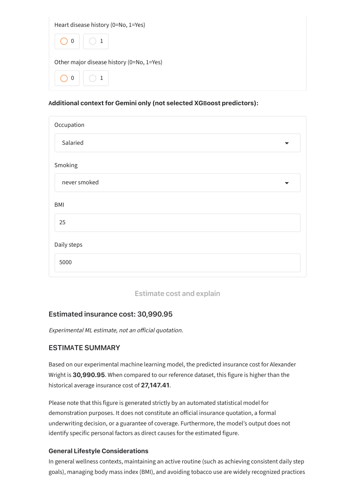
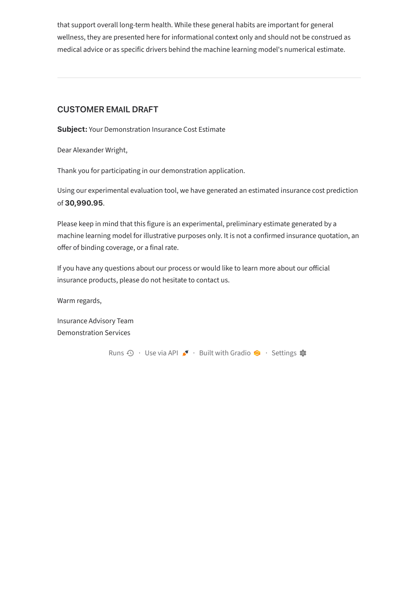
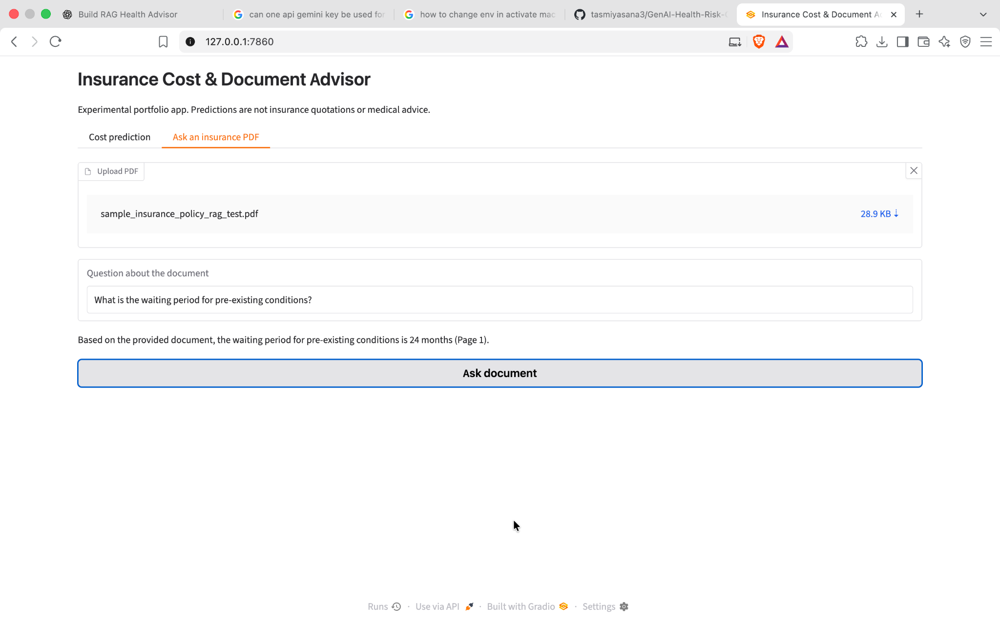
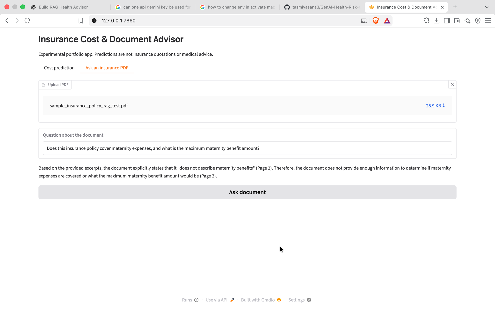

# Insurance Cost & Document Advisor — V2

An experimental insurance analytics application combining a trained machine learning pipeline, Gemini-generated customer advisories, and document-based question answering. Built with Python and Gradio, this project explores how predictive modeling and retrieval-augmented generation (RAG) can work together in a user-facing application.

> **Disclaimer:** This is a portfolio and research demonstration. Predictions are not insurance quotations, underwriting decisions, or medical advice. The PDF question-answering feature should not be relied on to determine coverage without reviewing the original policy.

## What the application does

The application has two independent workflows:

**Insurance cost estimation:** A user enters insurance and health-related attributes. The application validates the inputs, loads a saved scikit-learn prediction pipeline, and returns an estimated cost. Gemini uses that estimate, the customer profile, and historical dataset averages to prepare an explanatory summary and a customer email draft. **Gemini does not calculate the predicted cost.**

**Ask an insurance PDF:** A user uploads a text-based PDF and asks a question. The application extracts text, splits it into overlapping passages, ranks passages with TF-IDF and cosine similarity, and asks Gemini to answer using the retrieved excerpts with page references.

## What's new in V2

V2 moves the project from a notebook-oriented prototype toward a modular application with reusable inference services and a separate document Q&A workflow.

### Changes to the original ML workflow

The original exploratory analysis and core modeling objective were retained. The revised training workflow addresses several methodological issues identified in the earlier notebook:

| Area | Revision | Why it matters |
| --- | --- | --- |
| Column consistency | Standardized `regular_checkup_lasy_year` to `regular_checkup_last_year` in the modeling data | Keeps feature names consistent between training and inference |
| Categorical values | Corrected `Salried` to `Salaried` | Avoids unintended duplicate categories |
| Preprocessing leakage | Moved learned imputation, encoding, and applicable outlier thresholds into training-fold pipelines | Prevents information from validation/test data influencing preprocessing |
| Missing BMI | Fit median imputation using training data rather than the complete dataset | Supports a more defensible evaluation |
| Admission history | Treated missing `Year_last_admitted` as **unknown**, not automatically as never admitted; introduced recorded-status/category features | Avoids making an unsupported clinical assumption |
| Admission-year arithmetic | Removed the unsupported fixed-reference-year calculation | Avoids a misleading derived feature |
| Outliers | Preserved exploratory outlier analysis while comparing clipping strategies without automatically clipping the target | Separates exploratory observations from model-training decisions |
| Model development | Compared baseline and advanced regression candidates, with training-data cross-validation and validation RMSE used for selection | Makes model selection more systematic |
| Experimental features | Evaluated alternative feature sets, including an exploratory health-risk-score variant | Tests whether extra engineered features actually help |
| Reproducible inference | Exported a fitted scikit-learn pipeline and training metadata | Allows the application to predict without rerunning the notebook |

The revised notebook includes evaluation and diagnostic steps, but **this README does not claim a particular accuracy improvement** without confirming the saved `models/training_report.json`. The V2 application is described as using the exported XGBoost-based pipeline; its exact fitted configuration should be verified from the model artifact and training report.

### Application changes

- Separated model inference (`services/ml_service.py`) from the Gradio interface (`app.py`).
- Added required-feature validation and cached loading of the exported pipeline.
- Connected Gemini advisories to the **ML-generated estimate**, rather than asking the LLM to invent a premium.
- Added historical reference statistics through `services/data_service.py`.
- Added a PDF Q&A tab using TF-IDF retrieval, cosine similarity, and Gemini.
- Added a basic pytest test for missing model inputs.
- Improved error handling so an advisory-generation failure does not discard a successful ML estimate.

## Architecture

```text
                         Gradio (app.py)
                         /             \
                Cost prediction       Ask an insurance PDF
                       |                      |
              services/ml_service.py   services/rag_service.py
                       |                      |
              Saved fitted pipeline    PDF text extraction (pypdf)
                       |                      |
               Numerical estimate      Overlapping text chunks
                       |                      |
          services/advisory_service.py  TF-IDF vectors + cosine similarity
                       |                      |
               Gemini advisory         Top relevant excerpts + page labels
                       |                      |
               Summary + email         Gemini answer with page references

               config.py supplies shared Gemini configuration
```

The prediction and PDF workflows are independent; document retrieval does not currently change the insurance cost estimate.

## Current RAG approach: TF-IDF baseline

1. Read a PDF using `pypdf` and preserve page numbers.
2. Normalize whitespace and split each page into passages of up to **1,100 characters**, starting a new passage every **900 characters** (approximately **200 characters of overlap** between full consecutive passages).
3. Fit a `TfidfVectorizer` on the passages for the uploaded document.
4. Transform the user's question into the same TF-IDF feature space.
5. Use cosine similarity to select up to **four** matching passages.
6. Send the retrieved excerpts and their page labels to Gemini, asking it to answer only from the supplied context.

This is a **keyword-based retrieval baseline**. It does not yet use semantic embedding models, ChromaDB, or a persistent vector index. PDF extraction and vectorization run again for each question. Page references in generated answers are prompted, not independently verified. Scanned/image-only PDFs are not supported without OCR.

**Planned V3:** local sentence embeddings, persistent ChromaDB storage, document-scoped semantic retrieval, reusable indexes, improved chunking, and retrieval evaluation against the TF-IDF baseline.

## Project structure

```text
GenAI-Health-Risk-Cost-Advisor/
├── app.py                       # Gradio interface and event handlers
├── config.py                    # Project paths and Gemini client
├── insurance_transformers.py   # Custom preprocessing for saved pipeline
├── data/
│   └── Data.csv                 # Local training/reference dataset
├── notebooks/
│   └── Insurance_Cost_Integrated_Corrected_final.ipynb
├── models/
│   ├── insurance_pipeline.joblib
│   └── training_report.json
├── services/
│   ├── ml_service.py            # Model loading and inference
│   ├── data_service.py          # Historical dataset statistics
│   ├── advisory_service.py      # Gemini explanation and email
│   └── rag_service.py           # PDF extraction, retrieval, answer generation
├── tests/
│   └── test_ml_service.py
├── docs/
│   └── screenshots/              # Local demonstration screenshots
├── requirements.txt
└── README.md
```

## Run locally

Requirements: Python environment with the dependencies in `requirements.txt`, a fitted model artifact, and a Gemini API key.

```bash
# From the project root
python3 -m venv .venv
source .venv/bin/activate
python -m pip install -r requirements.txt
```

Create a local `.env` file:

```dotenv
GOOGLE_API_KEY=your_api_key_here
GEMINI_MODEL=your_supported_gemini_model
```

Never commit `.env` or your API key. The selected Gemini model must be supported by your account and integration.

The notebook is responsible for training and exporting `models/insurance_pipeline.joblib`. The companion `insurance_transformers.py` must be importable when the model is loaded. If you change feature engineering or preprocessing, retrain and re-export the pipeline.

Run the application:

```bash
python app.py
```

Open the local URL displayed in the terminal (typically `http://127.0.0.1:7860`).

Run the current automated validation test:

```bash
python -m pytest tests/test_ml_service.py -v
```

## Verification performed

- Exported the fitted pipeline and successfully reloaded it using `joblib`.
- Generated a prediction through `services/ml_service.py` using a dataset row.
- Confirmed the Gradio cost prediction and Gemini advisory render locally.
- Confirmed the PDF Q&A flow retrieves the example policy's **24-month pre-existing-condition waiting period** and displays a Page 1 reference.
- Tested a question about maternity coverage absent from the sample policy; the generated response acknowledged insufficient information and cited Page 2.
- Passed the missing-input validation test (`test_missing_fields`).

These are initial smoke tests, not a comprehensive model, RAG, or security evaluation.

## Application screenshots

The following examples were captured from the locally running Gradio application using **fictional demonstration data**. Outputs are illustrative and do not represent insurance quotations.

### Insurance cost estimate

For the sample profile *Alexander Wright*, the saved ML pipeline returned an estimated insurance cost of **30,990.95**. The Gemini advisory compares this with the dataset reference average of **27,147.41**; these values are specific to this example and dataset.

d

### Customer-facing advisory draft

Gemini uses the model estimate to generate an explanatory message and a draft customer email; it does **not** determine the numerical prediction.



### PDF question answering

For the fictional sample policy, the question *“What is the waiting period for pre-existing conditions?”* returned **24 months (Page 1)**. The system uses TF-IDF and cosine similarity to retrieve passages before sending them to Gemini.



The screenshots demonstrate local functionality, not an independently audited RAG evaluation. 

### Unsupported-question handling

As a basic grounding check, the same sample policy was asked: *“Does this insurance policy cover maternity expenses, and what is the maximum maternity benefit amount?”*

The application responded that the document **does not describe maternity benefits (Page 2)** and that there is **insufficient information** to establish maternity coverage or a maximum benefit amount. It did not invent a policy limit.



This is **one successful test case**, not proof that the system always avoids hallucinations or that its page citations are independently verified. The source document's actual terms must be reviewed for consequential decisions.

## Deployment

The application currently runs locally. **V2 has been demonstrated locally, not deployed to the existing Hugging Face Space.** The existing Space hosts an earlier version. The plan is to preserve V2 in Git and update the existing Space when a later version is ready. For any future deployment, include runtime dependencies, the exported model and custom transformer module, and configure `GOOGLE_API_KEY` as a Space secret. Never commit `.env`.

## Limitations and next steps

- Insurance cost predictions are experimental and should not be used for actual pricing or coverage decisions.
- The exploratory health-risk score is not a clinically validated measure.
- The PDF reader supports text-extractable PDFs only, up to the configured 100-page limit.
- TF-IDF may miss relevant passages when question wording differs substantially from the document.
- The RAG system currently reprocesses documents on every question and does not independently verify citations.
- Uploaded policy documents and retrieved excerpts should be handled with appropriate privacy controls before any real-user deployment.
- Future work includes semantic retrieval with ChromaDB, stronger document isolation, retrieval benchmarks, additional automated tests, and deployment validation.

## Versioning

**V2:** modular ML inference, Gemini advisory, and TF-IDF PDF RAG baseline.

**V3 (planned):** semantic embeddings, ChromaDB, document-scoped indexing, measured retrieval comparisons, an API layer, stronger tests, and deployment validation. These features are not part of V2.
